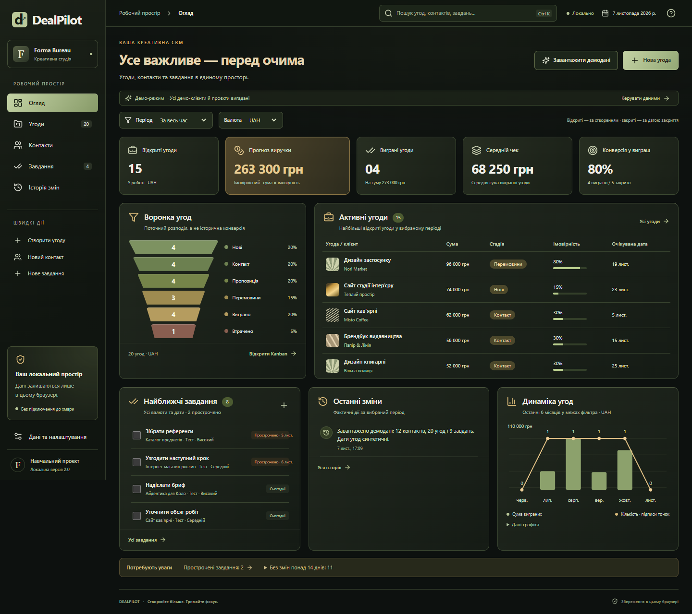
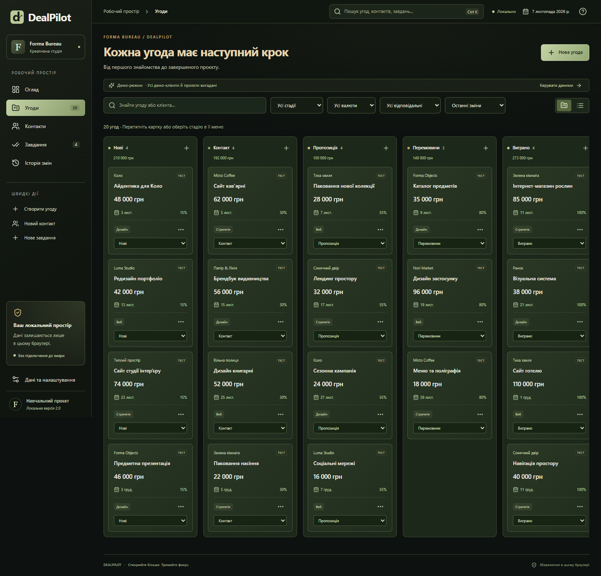
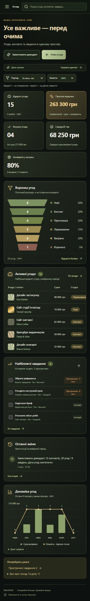

# DealPilot — локальна CRM для креативної студії

Самостійний навчальний кейс. Комерційного замовника, реальних відгуків або виміряного зростання продажів у цього проєкту немає.

**Завдання:** доопрацювати існуючу CRM так, щоб контакти, угоди, задачі та огляд працювали як узгоджений продукт, і перенести інтерфейс у темний візуальний стиль із шавлієвими й золотими акцентами.

**Рішення:** збережено React/TypeScript-основу, розширено модель угод статусами виграшу та втрати, часовими полями та подіями. Kanban, таблиця, форми, пошук і KPI використовують спільне збережене сховище. Угоду можна створити, пов’язати з контактом, перевести між стадіями, додати завдання і побачити результат в огляді.

Окрему увагу приділено достовірності показників: прогноз враховує ймовірність лише відкритих угод, валюти не змішуються, конверсія розраховується серед закритих угод. Порожня база не показує вигаданих результатів. Демо вмикається явно і містить лише синтетичні записи.

**Технології:** React, TypeScript, Vite, Zod, Lucide, SVG/CSS, localStorage, Vitest, Playwright.

**Результат:** робоча локальна демонстрація з адаптивним темним інтерфейсом, CRUD, доступною зміною стадій, історією, CSV та перевіреним JSON-перенесенням. Фактичні результати перевірок наведено в [QA_REPORT.md](QA_REPORT.md).

**Обмеження:** дані прив’язані до браузера. Немає сервера, авторизації, багатокористувацького доступу або справжніх інтеграцій. Цей кейс демонструє продуктову логіку та frontend-реалізацію, а не готовий хмарний сервіс.

