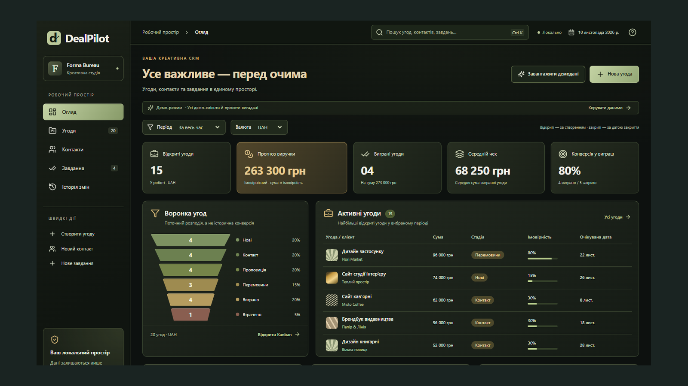

# DealPilot

Локальна CRM: контакти, угоди на Kanban-дошці, завдання, пошук та показники в окремих валютах. JSON-імпорт із перевіркою зв’язків, резервні копії й CSV-експорт. Темний адаптивний інтерфейс. Демопроєкт без хмарних акаунтів і командної синхронізації.



## Можливості

- Контакти, угоди, шість стадій Kanban, завдання, пошук і фільтри.
- KPI, прогноз і виграні суми окремо для UAH/USD/EUR; без конвертації.
- JSON-копії/імпорт із перевіркою зв’язків, CSV, контроль конфліктів вкладок і підтверджене відновлення.

## Технології

React 19, TypeScript, Zod, Vite, localStorage, Web Locks, IndexedDB (відбиток версії). Точні версії залежностей — у lock-файлах.

## Локальний запуск

```powershell
npm ci
npm run dev -- --port 5173 --strictPort
# http://127.0.0.1:5173
npm run build
```

Потрібен Node.js 22.12+ або 24. Підготовлений Windows-запускач і portable runtime описані в докладній інструкції.

## Межі демонстрації

Записи зберігаються в localStorage; IndexedDB містить тільки SHA-256 відбиток поточної версії для узгодження запису. Потрібні Web Locks, IndexedDB та HTTPS/localhost. При конфлікті друга дія відхиляється, автоматичного злиття немає. Немає сервера, справжніх акаунтів, командної синхронізації чи CSV-імпорту. Ліміт JSON 3 МБ. Не редагуйте localStorage вручну: невідповідність відбитка блокує запис; збережіть оригінал і використайте підтверджене відновлення.

## Перевірки й документація

Перевірка 2026-11-12–13: 27 unit і 20 E2E, ESLint, TypeScript та production build — PASS. Обидва `npm audit` (усі залежності та `--omit=dev`) — 0 відомих вразливостей. Production-інтерфейс перевірено в Edge на 390/768/1440 px. Нова регресія перевіряє експорт і відновлення 1 800 контактів поблизу ліміту JSON. Команди, результати, перервані запуски та межі перевірки — у [VALIDATION](docs/VALIDATION.md).

- [Поточний аудит](PROJECT_AUDIT.md)
- [Докладний запуск та технічні пояснення](docs/TECHNICAL_GUIDE.md)
- [Підготовка публікації](DEPLOYMENT.md)
- [GitHub](https://github.com/Forunell/Dealpilot)
- [Вихідний код портфоліо Artan](https://github.com/Forunell/site)

Власний демонстраційний проєкт, без вигаданих клієнтів і комерційних результатів. У розробці та аудиті використовувалися AI-інструменти; скриншоти відображають справжній інтерфейс.
