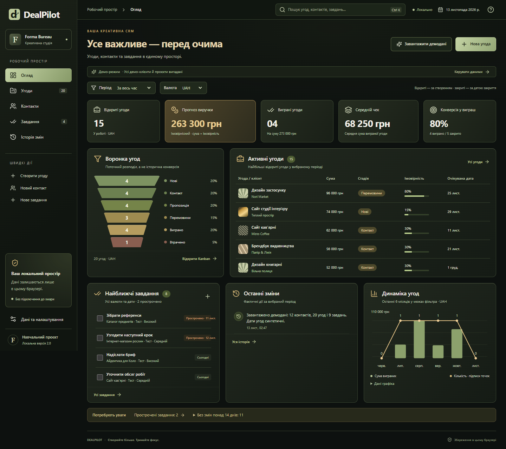
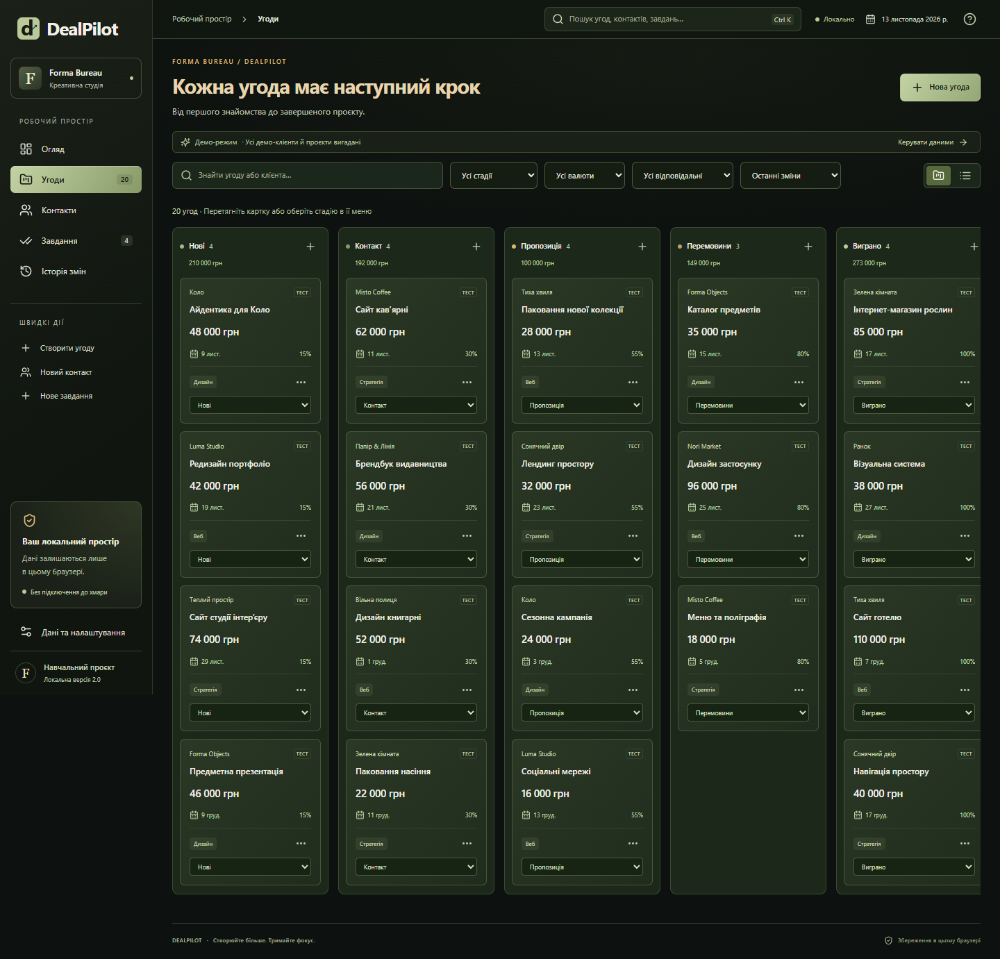
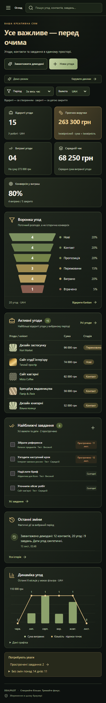

# Детальні інструкції та попередня документація

Команди нижче виконуються з кореня проєкту. Поточні результати аудиту — у [PROJECT_AUDIT.md](../PROJECT_AUDIT.md); старі QA-числа нижче описують попередні перевірки.

# DealPilot

Локальна CRM для креативної студії: контакти, угоди, Kanban, завдання та чесні показники в темному інтерфейсі. Самостійний навчальний кейс, без комерційного замовника. Українська мова, форматування uk-UA, валюти UAH/USD/EUR.

## Запуск на цьому Windows-комп’ютері

Подвійний клік на `start.cmd`, потім відкрийте адресу з термінала, зазвичай http://127.0.0.1:5173/.

Або PowerShell:

```powershell
cd D:\proek\DEALPILOT
powershell.exe -NoProfile -ExecutionPolicy Bypass -File .\start.ps1
```

Переносимий Node вже є в `.tools/node-v24.22.2-win-x64/`. Скрипт використовує його, якщо доступний; інакше потрібен встановлений Node 24. Вікно сервера залиште відкритим. Зупинка — Ctrl+C.

На іншому комп’ютері з Node 24:

```powershell
npm.cmd ci
npm.cmd run dev
```

Основне демо не потребує ключів, зовнішніх API або хостингу. Інтернет потрібен лише для встановлення залежностей. Після встановлення програма звертається до локального сервера; JSON читається у браузері, дані третім сторонам не передаються.

## Перший сценарій

Перший запуск порожній. Натисніть **«Завантажити демодані»**: 12 вигаданих контактів, 20 угод і 9 завдань. Історичні дати угод синтетичні; журнал містить реальну подію завантаження, а не вигадані дії працівників. За наявності записів заміна потребує підтвердження.

Створіть контакт, додайте угоду, задайте суму та ймовірність. Змініть стадію в Kanban перетягуванням або селектором. Завершіть угоду як «Виграно» або «Втрачено» й перевірте KPI. Додайте пов’язане чи незалежне завдання. Дані залишаються після перезавантаження.

## Що реалізовано

- Темний огляд: 5 KPI, поточний розподіл за стадіями, активні угоди, завдання, фактична історія, динаміка за 6 місяців.
- CRUD контактів, угод і завдань, валідація та підтвердження видалення.
- Шість стадій, таблиця і Kanban одних записів; фільтри, сортування, сторінки таблиці по 20 записів.
- Деталі угоди з контактом, нотатками, завданнями та подіями.
- Глобальний пошук і Ctrl/Cmd+K, швидкі дії, пріоритети та фільтри завдань.
- JSON-копії з перевіркою схеми/зв’язків та підтвердженням імпорту.
- CSV трьох розділів з UTF-8 BOM, лапками та захистом від формульної ін’єкції. CSV-імпорт не реалізовано.
- Назва робочого простору, демо та підтверджене очищення.

Повна матриця можливостей і меж — [FEATURES.md](../FEATURES.md), початковий аудит — [AUDIT.md](../AUDIT.md).

## Правила показників

Усі KPI, воронка, таблиця активних угод і динаміка використовують вибрану валюту. Перерахунку валют немає.

- Відкриті = статус open. Прогноз = сума amount × probability / 100 відкритих угод, кожен внесок округлюється до копійок. Це імовірнісний прогноз, не отримані платежі.
- Виграні = статус won. Середній чек = сума виграних / їх кількість. Без виграних — прочерк.
- Win-rate = won / (won + lost). Без закритих — прочерк і пояснення про відсутність даних.
- Період відкритих угод визначається датою створення, закритих — датою закриття; місяць/квартал/рік до поточного дня включно.
- Стадії показують поточний розподіл записів, а не історичну конверсію між етапами.
- Графік агрегує поточні виграні угоди за датою закриття. Подальша зміна суми або перевідкриття змінює підсумки. Це не бухгалтерський журнал.
- Завдання огляду охоплюють усі дати й валюти, що явно підписано. Історія фільтрується за часом дії, а не валютою.
- При повторному відкритті closedAt очищається; при новому виграші/втраті фіксується поточний час. Редагування без зміни закритої стадії зберігає попередній час.

## Дані, міграція та відновлення

Єдине джерело — App-стан, що оновлюється лише після успішного запису Repository. Zod перевіряє всю базу, унікальні ID, зв’язки, enum, дати та допустимі суми.

Ключ `dealpilot.data.v1` навмисно збережено для сумісності, але формат усередині — **version: 2**. При читанні v1 мігрує в пам’яті без перезапису оригіналу. Перед першою зміною стара база копіюється в `dealpilot.backup.v1`. Старе «Завершено» стає «Виграно». Невідомі дати не вигадуються: такі угоди враховані лише у «За весь час», не в графіку. `TEST_DATA/example.json` збережений у v1 як приклад сумісності.

Ліміт знімка — 3 МБ UTF-8, до 2 000 контактів, 5 000 угод, 10 000 завдань та 2 000 останніх подій. Історія може містити посилання на вже видалені сутності; вони не відновлюються автоматично.

Видалення контакту від’єднує його угоди, зберігаючи їх і задачі. Видалення угоди прибирає пов’язані задачі після попередження. Незалежні задачі залишаються.

При пошкодженому JSON програма блокує запис і пропонує завантажити оригінал. Лише явне підтвердження очищає базу. При помилці квоти дані та форми не видаються за збережені. Застарілий знімок іншої вкладки відхиляється; це захист від конфліктів, не спільне редагування.

Дані прив’язані до браузера, профілю, протоколу, адреси й порту. `localhost` та `127.0.0.1`, порти 5173 і 4173 — різні сховища. Очищення браузера може видалити записи; зберігайте JSON-копії. База не шифрується. React виводить введений HTML як текст.

## Стек і перевірки

React 19, TypeScript 5.9, Vite 7, Zod 4, Lucide, власні SVG/CSS, localStorage, Web Locks та IndexedDB для відбитка версії. Шрифти системні; сторонні фотографії не використовуються. Vitest перевіряє домен та Repository, Playwright — реальні сценарії в Microsoft Edge.

```powershell
cd D:\proek\DEALPILOT
$env:Path = "$PWD\.tools\node-v24.22.2-win-x64;$env:Path"
npm.cmd run typecheck
npm.cmd run lint
npm.cmd test
npm.cmd run build
npm.cmd run test:e2e
```

Playwright використовує встановлений Microsoft Edge, запускає локальний Vite автоматично або повторно використовує сервер на 127.0.0.1:5173. Результати — [QA_REPORT.md](../QA_REPORT.md). На системі без Edge потрібен відповідний браузер або налаштування каналу в `playwright.config.ts`.

Складання: `dist/`. Перегляд: `npm.cmd run preview`, далі адреса з термінала (зазвичай http://127.0.0.1:4173/). Не відкривайте dist через file://.

```text
src/domain.ts          схема, міграція, розрахунки, CSV, Repository
src/App.tsx            стан, екрани та операції
src/components.tsx     форми й модальні вікна
src/Dashboard.tsx      огляд і графік
src/GlobalSearch.tsx   пошук між сутностями
src/demo.ts            синтетичний набір
src/styles.css         базова адаптивна структура
src/dark.css           палітра і композиція огляду
src/*.test.ts          модульні перевірки
tests/*.spec.ts        браузерні сценарії
```

## Межі та публікація

Це локальний демонстраційний продукт. Немає сервера, облікових записів, ролей, командної синхронізації, платежів або інтеграцій. Проєкти й команда не заявлені як окремі модулі. Відповідальний — текстова мітка. Service worker відсутній; робота після зупинки сервера не гарантується.

`.gitignore` виключає залежності, збірку, переносимі інструменти, резервні копії, секретні env-файли й тимчасові звіти. Актуальні відомості про Git — у [GIT_PREPARATION](GIT_PREPARATION.md). Кейс для портфоліо — [PORTFOLIO_UA.md](../PORTFOLIO_UA.md).




